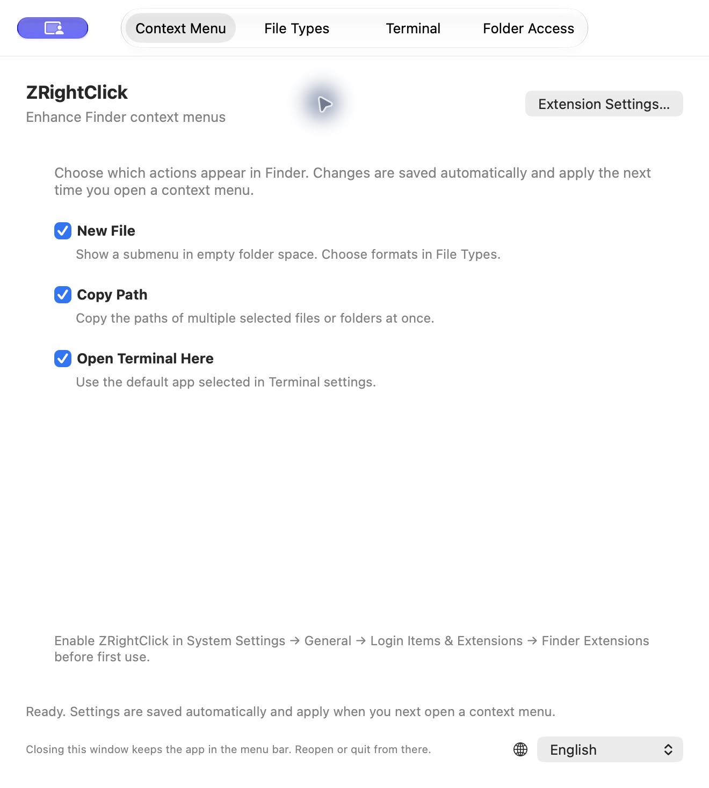

<div align="center">
  
  <h1>ZRightClick</h1>
  <p><strong>Your next action, one right-click away.</strong></p>
  <p>Create files, copy paths, and open your preferred terminal — right inside Finder.</p>
  <p>
    
    
    
  </p>
  <p><a href="README.md">简体中文</a> · <strong>English</strong></p>
  <p><a href="#features">Features</a> · <a href="https://github.com/inexom/ZRightClick/releases/latest">Download</a> · <a href="#get-started">Get started</a> · <a href="docs/DEVELOPMENT.md">Development</a> · <a href="https://github.com/inexom/ZRightClick/issues">Feedback</a></p>
</div>

---

ZRightClick is a native macOS Finder utility with a small set of everyday actions. Pick the menu entries you need, choose your file types and terminal, and keep the app in the menu bar while you work.

> **Project status:** version 1.0 is available as a universal macOS download. It is ad-hoc signed and **not notarized**; a Developer ID-signed or Mac App Store release is not available yet. Source visibility does **not** grant a software license; see [Usage and copyright](#usage-and-copyright).

## Features

| Action | What you get |
| --- | --- |
| **New File** | A two-level Finder menu with built-in `.txt`, `.md`, `.docx`, `.xlsx`, and `.pptx` types, each with an icon. |
| **Custom file types** | Add extensions such as `.js`, `.py`, `.json`, or `.d.ts` to create empty files. Enable or disable built-in types; add or remove custom types. |
| **Copy Path** | Copy the paths of multiple selected files or folders in one action. |
| **Open Terminal Here** | Choose Terminal, iTerm2, Ghostty, or Warp. Missing apps are marked; an unavailable preferred terminal falls back to Terminal for that request. |
| **Menu bar residence** | Close the settings window to hide the Dock icon and keep running. Reopen settings or quit from the menu bar. |
| **Two languages** | Switch between English and Simplified Chinese immediately. Your choice is saved and shared with the Finder extension. |

Each top-level action has its own switch. Settings are saved automatically and apply when you next open the Finder menu.

## A native settings window

<p align="center">
  
</p>

The app uses **SwiftUI + AppKit**, with a **FinderSync extension** for context menus. It has no third-party package dependencies.

## Get started

### Download 1.0

[**Download DMG**](https://github.com/inexom/ZRightClick/releases/download/v1.0/ZRightClick-1.0-universal.dmg) · [ZIP](https://github.com/inexom/ZRightClick/releases/download/v1.0/ZRightClick-1.0-universal.zip) · [Release notes and checksums](https://github.com/inexom/ZRightClick/releases/tag/v1.0)

1. Open the DMG and drag **ZRightClick.app** into **Applications**. For the ZIP, extract it and move the app to Applications.
2. Launch the app from Applications, then enable the Finder extension as described below.
3. This build is **not notarized**. If macOS blocks it, verify the source and checksum, then follow [Apple's instructions for opening apps](https://support.apple.com/102445), including **System Settings → Privacy & Security → Open Anyway** when available.

The same download contains **arm64 and x86_64** code. macOS 15 or later is required. Existing settings and saved folder access are kept when updating the same application in place.

### Requirements

- **To run:** macOS 15 or later.
- **To build:** Xcode with the macOS SDK and command-line tools. The included project was verified with **Xcode 27.0 beta**; older Xcode versions have not been verified.
- **For template validation:** Python 3. The application itself does not require Python.

### Build and install locally

```sh
git clone https://github.com/inexom/ZRightClick.git
cd ZRightClick
./scripts/dev.sh
```

The script builds **Release**, replaces `/Applications/ZRightClick.app`, registers the Finder extension, launches the app, and **restarts Finder**. It stops if the build fails. This is a local development installation, not a signed distribution installer.

Alternatively, open `ZRightClick.xcodeproj` in Xcode and select the **ZRightClick** scheme. See the [development guide](docs/DEVELOPMENT.md) for the build-only command, signing notes, and checks.

### Enable the Finder extension

1. Open **System Settings → General → Login Items & Extensions → Finder Extensions** and enable **ZRightClick**. The exact labels may differ by macOS version.
2. Open ZRightClick and choose which actions appear in Finder.
3. Right-click empty space in a regular folder to use **New File**. Select files or folders to copy their paths or open a terminal at the relevant location.
4. On first file or terminal access, select the target folder or a parent folder in the system permission dialog.

Permissions are saved for reuse. Creating files needs **read/write** access; opening a terminal can use **read-only** access. Review or remove saved permissions in **Folder Access**.

## Details that matter

### Files that behave like files

- Office documents use bundled blank templates. **Microsoft Office is not required to create them.** Opening them later requires a compatible application.
- New files are named `Untitled.ext` in English or `未命名.ext` in Chinese. Collisions receive a number; existing files, folders, and symbolic links are never overwritten.
- Finder selects the new file without opening an editor. Press **Return** to rename it.
- Custom extensions create empty files. Known formats that require structured content, such as PDF, images, and legacy Office files, are rejected as custom empty-file types.

### Your terminal, your preference

Choose the default app in **Terminal** settings. Fresh installations default to macOS Terminal. The app displays installed applications and includes a folder-picker test that does not save additional folder permissions.

If your selected terminal is removed or its launch request fails, ZRightClick tries Terminal for that request and keeps your saved preference. Third-party terminals may need their own first-run setup.

### Saved access, explicit control

Both the host app and Finder extension keep **App Sandbox** enabled. The extension forwards a fixed action and path to the host; the host requests access through the system folder picker and stores security-scoped bookmarks.

Terminal launching uses application URLs, not generated shell commands or Apple Events. Saved folder access can be removed in settings. The app's own text switches languages; system-owned file-picker controls follow macOS.

## FAQ

<details>
<summary><strong>The Finder menu is missing. What should I check?</strong></summary>

Enable the Finder extension in System Settings, confirm the relevant menu switch is on, and close and reopen the context menu. Try an ordinary folder rather than a search or other virtual Finder view. For development installation issues, run `./scripts/dev.sh status` and see [troubleshooting](docs/DEVELOPMENT.md#troubleshooting).

</details>

<details>
<summary><strong>Do I need to authorize the same folder every time?</strong></summary>

Normally, no. The app saves a security-scoped bookmark and restores access when needed, including after quitting the host. You may need to authorize again if the saved access becomes invalid or is removed. A previous read-only grant is not silently upgraded to write access.

</details>

<details>
<summary><strong>Does closing the window quit the app?</strong></summary>

No. Closing the window releases the settings interface and hides the Dock icon while the menu bar entry remains. Choose **Quit ZRightClick** to stop the host. macOS manages the Finder extension separately; a later Finder action can launch the host again.

</details>

<details>
<summary><strong>Are all supported terminals fully tested?</strong></summary>

Terminal, iTerm2, and Ghostty have been exercised locally. Warp's launch request was accepted, but its actual shell directory has not been verified past first-run setup. See [validation scope](docs/DEVELOPMENT.md#validation-scope) for the current limits.

</details>

## Development and feedback

Run the Foundation-level tests and document-template checks with:

```sh
./scripts/test.sh
```

The [development guide](docs/DEVELOPMENT.md) covers architecture, local builds, manual Finder checks, and known limitations. Bug reports, feature suggestions, and translation feedback are welcome through [GitHub Issues](https://github.com/inexom/ZRightClick/issues).

## Usage and copyright

Copyright © 2026 [inexom](https://github.com/inexom). All rights reserved.

**No software license is currently granted.** Public source visibility does not grant permission to use, modify, redistribute, or commercially exploit this software. Commercial use by others requires the copyright holder's permission. GitHub's platform rights to view and fork public repositories remain governed by its Terms of Service. See [GitHub's explanation of repositories without a license](https://docs.github.com/en/repositories/managing-your-repositorys-settings-and-features/customizing-your-repository/licensing-a-repository).
