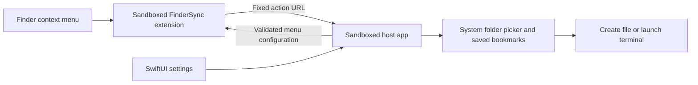

# Development guide

[English overview](../README.md) · [中文介绍](../README.zh-CN.md)

ZRightClick targets macOS 15+. The current project has been built with Xcode 27.0 beta. It uses Foundation, AppKit, SwiftUI, UniformTypeIdentifiers, and FinderSync, with no third-party package dependencies.

## Build without installing

```sh
xcodebuild \
  -project ZRightClick.xcodeproj \
  -scheme ZRightClick \
  -configuration Release \
  -destination 'platform=macOS' \
  CONFIGURATION_BUILD_DIR="$PWD/build" \
  build
```

This command builds the application and embedded extension without replacing the installed copy or restarting Finder. Open `ZRightClick.xcodeproj` to configure signing for your environment if required. Signing identities, certificates, and provisioning profiles are not included.

For the full local development loop:

```sh
./scripts/dev.sh          # Release build, replace installed app, register extension, restart Finder
./scripts/dev.sh debug    # The same workflow using Debug
./scripts/dev.sh status   # Registration and extension-process status
./scripts/dev.sh logs     # Recent app and extension logs
./scripts/dev.sh log      # Live app and extension logs
```

The install script replaces `/Applications/ZRightClick.app`. Registering the installed extension, launching the host, and then restarting Finder are intentional: multiple registered copies and stale extension processes can prevent the expected build from loading. Build failures stop installation.

The development setup has been verified locally with ad-hoc signing. Distribution signing, notarization, App Store provisioning, and review have not been completed.

## Tests

```sh
./scripts/test.sh
```

Requires Xcode command-line tools and Python 3. The script compiles four independent Foundation-level test executables into a temporary directory, runs them, validates the bundled Office templates, and cleans up its executables. It does not install the app, restart Finder, or change the application's saved preferences.

| Suite | Coverage |
| --- | --- |
| Terminal requests | URL validation, special characters, directory component boundaries. |
| Terminal preferences | First-run defaults, legacy migration, persisted choice, missing-app fallback, safe terminal URLs. |
| New files | Configuration validation and transport, request boundaries, exclusive creation, symbolic-link collisions, concurrent naming. |
| Localization | Legacy settings, language round-trip, dynamic titles and errors, unchanged user content, formatting, names in both languages. |
| Office templates | ZIP/XML structure, internal relationships, expected blank content, absence of macros and external links. |

These tests do not replace actual Finder and system-permission checks.

## Architecture



| Location | Responsibility |
| --- | --- |
| `Shared/MenuConfiguration.swift` | File types, settings model, input validation, cross-process configuration transport. |
| `Shared/Localization.swift` | Bilingual app text, thread-safe current language, in-process change notification. |
| `Shared/FileTypeIcon.swift` | Small tinted system-symbol file icons. |
| `ZRightClickFinderExtension/FinderSync.swift` | Directory observation, dynamic menus, action targets, host handoff. |
| `ZRightClickApp/AppDelegate.swift` | App lifecycle, settings window, menu bar, Dock visibility, incoming URLs. |
| `ZRightClickApp/ContentView.swift` | Menu switches, types, terminal selection, access management, language picker. |
| `ZRightClickApp/MenuSettings.swift` | Settings persistence, publication, and custom-type validation. |
| `ZRightClickApp/DirectoryAccessStore.swift` | Bookmark persistence, scope restoration, permission levels, stale-bookmark refresh. |
| `ZRightClickApp/FileActionController.swift` | Serialized Finder actions and terminal testing. |
| `ZRightClickApp/TerminalPreference.swift` | Allowed terminals, migration, fallback selection, directory URL construction. |
| `ZRightClickApp/TerminalSettings.swift` | Installed-app detection, persisted preference, launch requests. |
| `ZRightClickApp/NewFileWriter.swift` | Blank content, exclusive writes, collision numbering. |
| `ZRightClickApp/Templates/` | Bundled blank DOCX, XLSX, and PPTX templates. |
| `Design/` | Application icon master and asset provenance. |

### Settings synchronization

The host is the only settings editor. Host and extension keep separate sandboxed UserDefaults stores. Distributed notifications publish the validated configuration or request the latest copy; `userInfo` remains nil for App Sandbox compatibility.

The extension requests settings at startup and when constructing a menu, then caches received configuration. The host publishes at startup and after changes. The payload contains switches, language, type names, suffixes, and IDs; it contains no directory bookmarks or file contents. Payload size, type IDs, suffixes, and duplicates are validated. The host rechecks its own configuration before performing a file action.

Language is an optional configuration field so older settings decode without resetting switches or custom types. App-owned text resolves in the current language. User-provided names, paths, and existing filenames are unchanged. Already-open Finder menus must be reopened to show a change.

### File access and actions

The Finder extension keeps App Sandbox enabled and forwards only a fixed action, target path, and validated type identifier. The host requests access using `NSOpenPanel`, saves an app-scoped security bookmark, and restores the scope for each operation.

Read-only grants can open a terminal. File creation requires a read/write grant, and old read-only grants are not silently upgraded. Directory coverage is compared by path component after resolving symbolic links. Security scope stays active until the operation finishes.

File creation uses exclusive writes and refuses to overwrite existing files, folders, or symbolic links. Office templates are copied from the app bundle. Custom file types produce empty files, with known structured formats rejected.

Terminal, iTerm2, and Ghostty receive a directory URL through an explicitly selected application. Warp uses `warp://action/new_window?path=...`, with structured query encoding and explicit `+` escaping. No shell commands or Apple Events are generated. A failed or missing preferred terminal falls back to Terminal for that request without changing the stored preference.

### Window and process lifetime

Normal launch shows settings and a Dock icon. Closing settings hides the Dock icon, releases its SwiftUI hierarchy, and leaves the menu bar entry alive. Reopening rebuilds the window and restores its frame and selected tab within that process. Unsaved custom-type drafts are discarded when the window closes.

Settings, bookmarks, and pending operations outlive the window. Finder URL launches stay in the background. Explicit Quit stops the host; the independently managed Finder extension can launch it again for a later action.

Do not hold a state lock across AppKit drawing or distributed notification calls. The extension snapshots values under a short lock, then constructs menus outside it.

## Troubleshooting

- **No menu:** enable ZRightClick in System Settings → General → Login Items & Extensions → Finder Extensions. Test an ordinary directory, confirm the menu switch, and reopen the menu.
- **Wrong development build:** run `./scripts/dev.sh status` and check the registered extension path. Avoid retaining multiple installed copies with the same bundle ID.
- **New File missing on a file selection:** creation is intentionally offered only for a folder's empty-space menu.
- **Permission failure:** select the target directory or a parent. Creating files requires write access. Remove an invalid saved entry in Folder Access, then retry.
- **Terminal opens its setup screen:** complete that terminal's own initial configuration before testing the working directory.
- **Menu wording does not change immediately:** close and reopen the Finder context menu. Settings changes affect newly constructed menus.

## Validation scope

Local integration checks have covered the three menu switches, custom types, built-in template creation, Finder selection, saved access after host exit, terminal fallback, language switching, and settings recreation after closing the window. They are manual checks, not automated UI coverage.

Terminal and iTerm2 have been exercised locally. Ghostty 1.3.1 was tested with directory paths containing Chinese characters, spaces, `&`, and `+`, including shell working-directory inspection. Warp accepted launch requests, but its actual shell working directory was not verified after first-run setup. Temporary third-party terminal installations used for testing were removed; they are not bundled.

Office template package structure, relationships, blank content, and independent parsing/rendering were checked. Native Microsoft Office opening, a physical machine reboot, and actual bookmark invalidation have not been fully tested.

The New File submenu parent can close the menu when clicked. Clearing the AppKit parent action did not change Finder's behavior in local experiments. No private API or menu-injection workaround is used.

## Memory measurements

Use a Release build and compare `vmmap -summary <PID>` **Physical footprint** for the host and extension separately. RSS is a different metric. Record the state of the settings window and which pages have been visited.

One local comparison on 2026-10-23, in `vmmap` M:

| Same interaction state | Earlier Debug build retaining UI | Release build releasing UI |
| --- | ---: | ---: |
| Fresh settings window | 35.5 | 35.5 |
| First window close | 39.0 | 35.3 |
| Visit terminal settings, then close | 44.8 | 41.6 |
| Visit every tab, repeatedly reopen and close | 51.9 | 51.5 |

Heap inspection found the settings hosting view retained in the earlier build and absent after closing the newer one. Framework and allocator caches can retain memory pages after objects are released. These are single-machine observations, not guaranteed memory savings or a long-term footprint limit.
